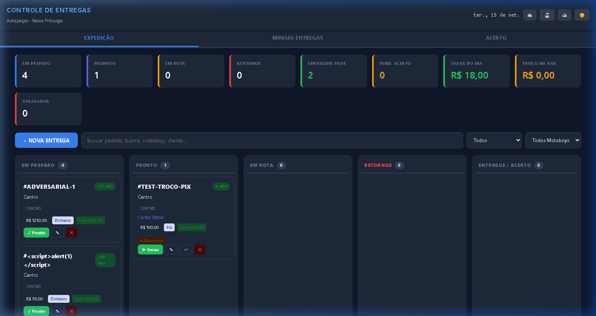
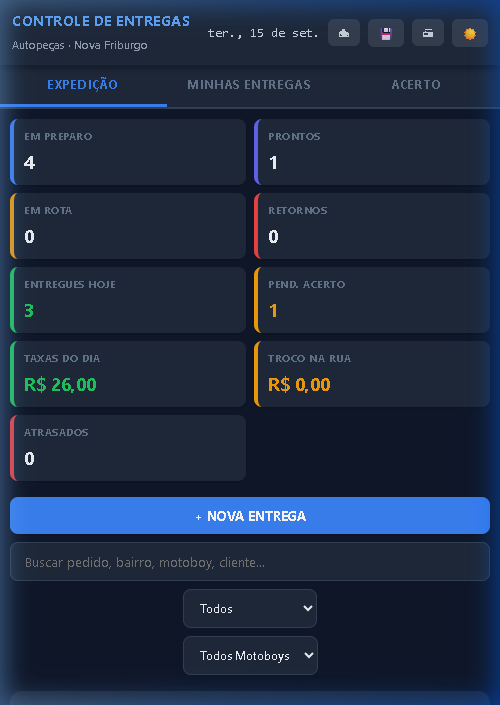
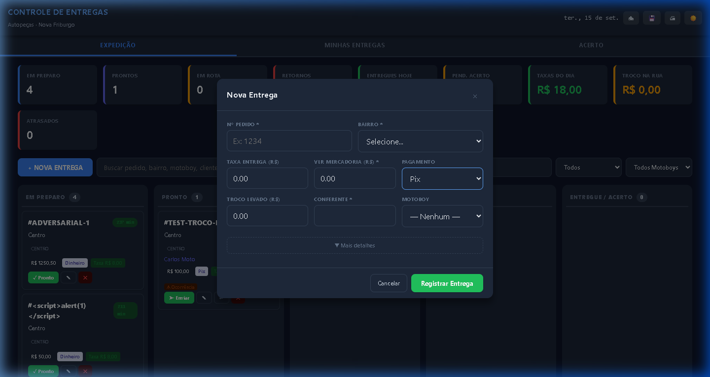
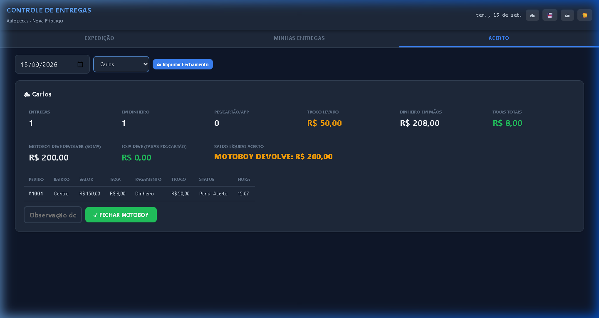
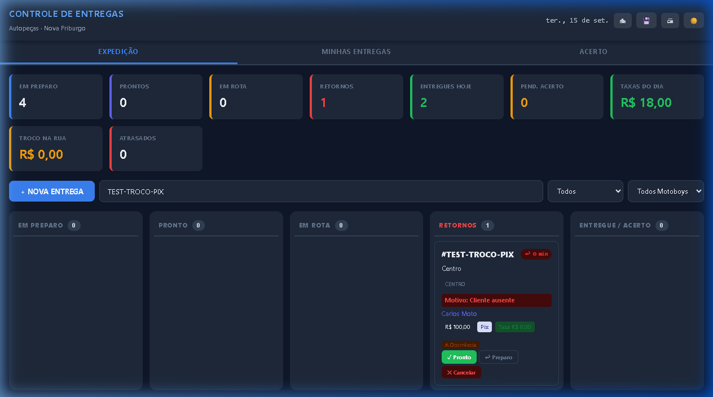

# Controle de Entregas — Autopeças

> **PWA offline-first para gerenciamento de expedição, entregas e acerto financeiro de uma operação de autopeças.**

[](https://wallacextreme.github.io/controle-entregas-friburgo/)
[](https://wallacextreme.github.io/controle-entregas-friburgo/)
[](#)
[](#)
[](#)

---

## 🌐 Demo Online

* **Aplicação em Produção (GitHub Pages)**: [https://wallacextreme.github.io/controle-entregas-friburgo/](https://wallacextreme.github.io/controle-entregas-friburgo/)
* **Repositório Oficial**: [https://github.com/wallacextreme/controle-entregas-friburgo](https://github.com/wallacextreme/controle-entregas-friburgo)

> [!NOTE]
> A aplicação é 100% estática e client-side. Nenhum dado de clientes ou pedidos trafega por servidores externos; toda a persistência ocorre localmente no navegador via **IndexedDB**.

---

## 📸 Screenshots

### 1. Painel de Expedição & Quadro Kanban (Desktop)


### 2. Visão Mobile do Motoboy (Smartphones)


### 3. Nova Entrega com Proteção de Troco (Pix/Cartão desabilitam troco)


### 4. Módulo de Acerto & Fechamento Financeiro


### 5. Gestão de Ocorrências e Retorno de Rota


---

## 🎯 O Problema

Em balcões de autopeças com grande volume diário de saídas rápidas, o controle de entregas enfrenta desafios recorrentes:
* Incerteza do paradeiro físico de mercadorias despachadas para oficinas mecânicas;
* Conflitos de conferência entre trocos em dinheiro levados pelos motoboys e valores a devolver no caixa;
* Pedidos cancelados em trânsito ou mercadorias com endereço incorreto que retornam sem registro formal de ocorrência;
* Dependência de planilhas manuais em papel suscetíveis a perda ou falhas de anotação;
* Necessidade de um sistema ágil que não dependa de mensalidades de SaaS ou conexão contínua com a internet.

---

## 💡 A Solução

O **Controle de Entregas** é uma Progressive Web App (PWA) autônoma, offline-first e projetada especificamente para o ritmo operacional de despacho:
* **Conferente/Expedição**: Visualiza em tempo real um Kanban de 5 colunas com semáforo de tempo de espera e eixos logísticos da cidade.
* **Entregador**: Acessa uma visão mobile limpa no smartphone com botões de acionamento imediato para navegação (Waze, Google Maps) e contato direto com o cliente via WhatsApp com texto pré-formatado.
* **Operador de Caixa**: Realiza o acerto individualizado por motoboy no fim do expediente, apurando dinheiro recebido na rua, trocos levados vs. devolvidos e taxas de entrega devidas.
* **Total Autonomia**: Funciona sem internet através de Service Worker e IndexedDB local, permitindo backup completo e restauração via arquivos JSON.

---

## 🚀 Principais Funcionalidades

| Módulo | Recursos |
|---|---|
| **Painel de Expedição** | Dashboard de métricas diárias, busca em tempo real por pedido/cliente/bairro, filtros por status e atalhos rápidos de teclado (`n` para nova entrega, `Esc` para fechar modais). |
| **Quadro Kanban (5 colunas)** | Fluxo operacional: `Em Preparo` → `Pronto para Saída` → `Em Rota` → `Retornos Pendentes` → `Concluído / Acerto`. Arrasto nativo (HTML5 Drag & Drop) e botões de avanço. |
| **Semáforo Logístico** | Indicador visual de tempo decorrido com cálculo automático de tolerância estendida para distritos remotos (>50 min) vs. bairros urbanos (>35 min). |
| **Visão do Motoboy** | Interface responsiva mobile-first com seletor de entregador, cartões de alta legibilidade, botões de rota direta no Waze e Google Maps, e link de WhatsApp para aviso de chegada. |
| **Tratamento de Exceções** | Módulo de retorno de entrega com motivo formal e opções de redespacho ou cancelamento; cancelamento com liberação de itens e histórico auditável de ocorrências. |
| **Acerto Financeiro** | Agrupamento de entregas finalizadas por motoboy, apuração líquida entre dinheiro em mãos e taxas devidas (`MOTOBOY DEVOLVE`, `LOJA PAGA` ou `ACERTO ZERADO`), e quitação em lote. |
| **Impressão Profissional** | Relatório Geral do Dia e Comprovante Individual de Acerto com CSS Paged Media limpo, omitindo botões e barras de navegação. |
| **Segurança de Dados** | Backup e restauração JSON validados por esquema estruturado, preservando dados legados e chaves primárias. |
| **PWA & Offline** | Web App Manifest configurado para modo `standalone`, ícones homologados (192px e 512px) e Service Worker com estratégia de cache. |

---

## 🏗️ Arquitetura do Sistema

O projeto adota uma arquitetura em camadas bem desacoplada dentro de Vanilla JavaScript moderno, dispensando frameworks pesados ou ferramentas de build:

```text
┌─────────────────────────────────────────────────────────┐
│                    Camada de Apresentação (UI)          │
│       Kanban Board · Motoboy Mobile View · Acerto       │
│                 Event Delegation & Modais               │
└────────────────────────────┬────────────────────────────┘
                             │
┌────────────────────────────▼────────────────────────────┐
│                    Camada de Serviços                   │
│    DeliveryService · SettlementService · BackupService   │
│             State Machine · Concurrency Mutex           │
└────────────────────────────┬────────────────────────────┘
                             │
┌────────────────────────────▼────────────────────────────┐
│                  Camada de Repositórios                 │
│                 DeliveryRepo · MotoboyRepo              │
└────────────────────────────┬────────────────────────────┘
                             │
┌────────────────────────────▼────────────────────────────┐
│              Camada de Persistência Local               │
│               IndexedDB (LogisticaFriburgoDBv3 v2)      │
└─────────────────────────────────────────────────────────┘
```

### Arquitetura PWA & Cache
```text
                     Navegador
                         │
     ┌───────────────────┴───────────────────┐
     ▼                                       ▼
Requisições HTTP                          DOM / UI
     │                                       │
     ▼                                       ▼
Service Worker (sw.js)                IndexedDB (Local)
 ├── Cache Storage                    └── Transações ACID
 └── Offline Fallback
```

---

## ⚙️ Destaques de Engenharia

* **Valores Financeiros em Centavos Inteiros (`cents`)**: Todas as variáveis monetárias (`totalCents`, `changeForCents`, `calculatedFeeCents`) são armazenadas e calculadas como inteiros. Isso elimina os erros de imprecisão de ponto flutuante inerentes ao padrão IEEE 754 no JavaScript (`0.1 + 0.2 !== 0.3`).
* **Proteção Contra Troco Fantasma**: Validação ativa na camada de serviço e na interface que zera e bloqueia o campo de troco caso a forma de pagamento selecionada seja Pix, Cartão de Débito, Cartão de Crédito ou Faturado.
* **State Machine Determinística**: O ciclo de vida de uma entrega obedece a uma matriz estrita de transições válidas com 8 estados possíveis (`PREPARO`, `READY`, `OUT_FOR_DELIVERY`, `RETURN_PENDING`, `DELIVERED`, `SETTLEMENT_PENDING`, `SETTLED`, `CANCELLED`), impedindo saltos operacionais ilegais.
* **Migração de Dados Versionada & Idempotente**: A transição do schema v1 para v2 converte valores legados de float para centavos, atribui IDs sequenciais e armazena os dados brutos originais em `_legacyData`. Execuções sucessivas não corrompem ou duplicam dados.
* **Mutex Assíncrono para Concorrência**: Operações de mutação no IndexedDB são serializadas através de uma trava lógica (`mutex`), prevenindo condições de corrida (*race conditions*) durante requisições rápidas.
* **Sanitização Rigorosa Contra XSS**: Todos os campos textuais fornecidos pelo usuário passam por função de escape HTML antes de qualquer injeção no DOM.
* **Event Delegation Centralizado**: O quadro Kanban utiliza escuta de eventos delegada nos containers pai, evitando vazamento de memória (*memory leaks*) ao recriar cards no DOM.

---

## 🧪 Qualidade e Testes

A release `v4.0.2` passou por homologação adversarial e auditoria técnica automatizada:

* **136 Testes Automatizados Unitários**: Cobrindo State Machine (22 testes), Parser Monetário (15 testes), Cálculos de Acerto (16 testes), Tratamento de Troco Fantasma (5 testes), Configurações de Bairros (14 testes), Semáforo de Espera (6 testes), Sanitização XSS (8 testes), WhatsApp URLs (7 testes), Backup/Restore (7 testes), Migração v1→v2 (5 testes), Integridade Financeira de Lote (10 testes) e Mutex (6 testes).
* **17 Testes Interativos de Navegador**: Validação completa de ciclo de entrega, fluxos de retorno, cancelamento, quitação, responsividade em dispositivos móveis (360×800, 390×844) e telas desktop (1024×768, 1920×1080).
* **Zero Falhas Bloqueadoras**: 0 falhas críticas, 0 falhas altas e 0 falhas médias registradas no relatório final de Go-Live.

A documentação detalhada das rodadas de teste está disponível em [docs/GO-LIVE.md](docs/GO-LIVE.md).

---

## 📋 Como Executar

Por ser uma aplicação web estática construída com JavaScript puro e sem dependências externas de compilação:

### Opção 1: Acesso Direto Online
Acesse diretamente o endereço publicado no GitHub Pages:  
👉 **[https://wallacextreme.github.io/controle-entregas-friburgo/](https://wallacextreme.github.io/controle-entregas-friburgo/)**

### Opção 2: Execução Local
1. Clone o repositório:
   ```bash
   git clone https://github.com/wallacextreme/controle-entregas-friburgo.git
   cd controle-entregas-friburgo
   ```
2. Abra o arquivo `index.html` em qualquer navegador moderno, ou utilize um servidor estático local:
   ```bash
   npx serve .
   # ou com Python:
   python -m http.server 8080
   ```

---

## 🧪 Roteiro de Demonstração

Para experimentar todas as etapas do fluxo operacional com dados fictícios:

1. **Abrir a Aplicação**: Acesse a Demo Online e clique em **Nova Entrega** (ou pressione a tecla `n`).
2. **Cadastrar Entrega**:
   * Nº do Pedido: `1001`
   * Cliente: `Oficina Mecânica Centro`
   * Bairro: Escolha `Centro` (taxa calculada automaticamente)
   * Pagamento: `Dinheiro`
   * Valor: `120,00`
   * Troco para: `200,00` (troco a devolver calculado: `R$ 80,00`)
3. **Avançar no Kanban**:
   * Clique em **Pronto** para mover de `Em Preparo` para `Pronto para Saída`.
   * Selecione um motoboy (ex: `Carlos`) e clique em **Despachar**. O pedido passa para `Em Rota`.
4. **Visão do Motoboy**:
   * Alterne para a aba **Minhas Entregas**.
   * Filtre por `Carlos` e veja o card com atalhos de navegação e WhatsApp.
   * Clique em **Concluir Entrega**.
5. **Acerto Financeiro**:
   * Alterne para a aba **Acerto**.
   * Visualize o resumo do motoboy Carlos: valor retido em dinheiro, troco e taxa devida.
   * Clique em **Quitar Acerto**.

---

## ⚠️ Limitações Conhecidas

* **Operação Multi-Aba**: O estado reativo em memória (`AppState`) é otimizado para uma única aba ativa. Modificações em uma segunda aba concorrente não disparam atualização em tempo real na primeira sem recarregar. Recomenda-se um dispositivo/aba por posto de atendimento.
* **Sincronização em Nuvem**: A aplicação foi desenhada como *Local-First / Offline-First*. Não há banco de dados centralizado em servidor na versão atual.
* **Rotina de Backup**: A segurança dos dados depende da exportação periódica do arquivo de backup JSON pelo operador na aba de Acerto.

---

## 📚 Documentação Adicional

* [Manual de Operação do Usuário](docs/MANUAL.md) — Guia passo a passo para conferentes e entregadores.
* [Documentação Técnica e Arquitetura](docs/TECHNICAL.md) — Detalhamento técnico de schemas, state machine e algoritmos.
* [Relatório de Homologação Go-Live](docs/GO-LIVE.md) — Resultados completos da suíte de 136 testes e homologação final.
* [Histórico de Mudanças](CHANGELOG.md) — Registro das melhorias e versões da aplicação.

---
## ☕ Apoie este Projeto

Se este projeto ou código foi útil para você, considere apoiar o meu trabalho com uma doação espontânea de qualquer valor. Sua contribuição ajuda a manter o desenvolvimento de novas ferramentas e soluções open-source!

<details>
<summary><strong>💠 Clique aqui para exibir os dados do PIX (Doação Voluntária)</strong></summary>

<br>

- **Chave PIX (ALEATORIA):** `91afe4f0-a466-4423-9d9c-d6a0ffea9b3e`
- **Banco:** C6 Bank
- **Titular:** Wallace de Paulo Soares

> *Nota Legal: Contribuição 100% voluntária e espontânea de apoio ao desenvolvedor (Art. 538 do Código Civil).*
</details>
