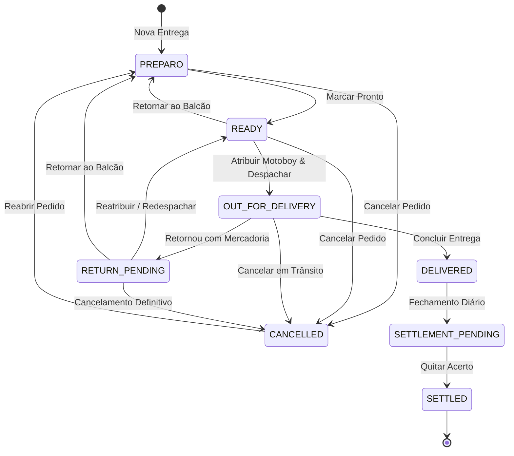

# Documentação Técnica e Arquitetural — Controle de Entregas v4.0.2

Esta documentação detalha a engenharia de software, modelos de dados, algoritmos e decisões arquiteturais implementadas no **Controle de Entregas — Autopeças**.

---

## 1. Visão Geral da Arquitetura

O sistema é construído como uma aplicação de página única (SPA) estática utilizando **Vanilla JavaScript (ES6+)**, sem frameworks ou dependências externas de runtime. A estrutura interna segue o padrão de **Arquitetura em Camadas**:

```text
┌─────────────────────────────────────────────────────────────┐
│                   Apresentação (UI Layer)                   │
│   Renderers (Kanban, Motoboy, Acerto), Modais, Handlers     │
│             Event Delegation e Microinterações              │
└──────────────────────────────┬──────────────────────────────┘
                               │
┌──────────────────────────────▼──────────────────────────────┐
│                    Serviços (Service Layer)                 │
│         DeliveryService · SettlementService · BackupService │
│          Validação de Regras · Mutex de Concorrência        │
└──────────────────────────────┬──────────────────────────────┘
                               │
┌──────────────────────────────▼──────────────────────────────┐
│                  Repositórios (Repository Layer)            │
│                  DeliveryRepo · MotoboyRepo                 │
│                 Abstração de Operações CRUD                 │
└──────────────────────────────┬──────────────────────────────┘
                               │
┌──────────────────────────────▼──────────────────────────────┐
│                  Persistência (Database Layer)              │
│            Wrapper Promisificado sobre IndexedDB            │
│          LogisticaFriburgoDBv3 (Versão de Schema: 2)        │
└─────────────────────────────────────────────────────────────┘
```

---

## 2. Camada de Persistência (IndexedDB)

### 2.1 Schema do Banco de Dados
* **Nome do Banco**: `LogisticaFriburgoDBv3`
* **Versão Ativa**: `2`

O banco é composto por três *Object Stores*:

1. `entregas`: Armazena todos os pedidos e seus respectivos ciclos de vida.
   * Chave primária: `id` (inteiro sequencial).
   * Índices:
     * `status`: Busca e agrupamento por estado da entrega.
     * `motoboyId`: Filtragem de corridas atribuídas por entregador.
     * `createdAt`: Ordenação temporal e relatórios diários.
     * `settled`: Filtro booleano para pendências financeiras.
2. `motoboys`: Cadastro dos entregadores ativos.
   * Chave primária: `id` (inteiro sequencial).
   * Campos: `name`, `phone`, `active`, `createdAt`.
3. `config`: Configurações operacionais persistidas.
   * Chave primária: `key` (string).

### 2.2 Estrutura do Documento de Entrega (`DeliveryItem`)
```typescript
interface DeliveryItem {
    id: number;
    orderNumber: string;
    customerName: string;
    phone: string;
    destination: {
        address: string;
        bairro: string;
        eixo: 'Centro' | 'Sul' | 'Norte' | 'Distritos';
    };
    payment: {
        method: 'Dinheiro' | 'Pix' | 'Cartao_Debito' | 'Cartao_Credito' | 'Faturado';
        totalCents: number;       // Valor total em centavos inteiros
        changeForCents: number;   // Troco para quanto em centavos (0 se não dinheiro)
    };
    calculatedFeeCents: number;   // Taxa de entrega devida em centavos
    status: DeliveryStatus;
    motoboyId: number | null;
    motoboyName: string | null;
    timestamps: {
        createdAt: string;        // ISO 8601
        readyAt?: string;
        departedAt?: string;
        deliveredAt?: string;
        returnedAt?: string;
        cancelledAt?: string;
        settledAt?: string;
    };
    occurrences: Array<{
        type: 'RETURN' | 'CANCELLATION' | 'NOTE';
        timestamp: string;
        reason: string;
        notes?: string;
    }>;
    settled: boolean;
    _legacyData?: object;         // Backup imutável de registros legados v1
}
```

---

## 3. Migração de Dados (v1 → v2)

Para garantir compatibilidade com versões prévias do sistema sem perda de registros históricos, o método `migrateData()` executa de forma automática e **idempotente**:

1. **Conversão Monetária**: Registros legados armazenavam valores monetários como ponto flutuante em reais (`120.50`). A rotina converte para centavos inteiros via `Math.round(val * 100)`, evitando discrepâncias de arredondamento.
2. **Preservação de Identificadores**: IDs prévios são validados e mantidos sequenciais.
3. **Imutabilidade do Legado**: Os dados brutos originais são copiados no campo `_legacyData`.
4. **Idempotência**: A migração marca cada registro processado com `schemaVersion: 2`. Tentativas sucessivas ignoram itens já migrados.

---

## 4. State Machine Operacional

O ciclo de vida das entregas é regido por uma Máquina de Estados Finita determinística com 8 estados:



### Matriz de Transições Válidas
```javascript
const STATUS_TRANSITIONS = {
    PREPARO: ['READY', 'CANCELLED'],
    READY: ['OUT_FOR_DELIVERY', 'PREPARO', 'CANCELLED'],
    OUT_FOR_DELIVERY: ['DELIVERED', 'RETURN_PENDING', 'CANCELLED'],
    RETURN_PENDING: ['READY', 'PREPARO', 'CANCELLED'],
    DELIVERED: ['SETTLEMENT_PENDING'],
    SETTLEMENT_PENDING: ['SETTLED'],
    SETTLED: [],             // Estado terminal
    CANCELLED: ['PREPARO']   // Permite reabertura com justificativa
};
```
Qualquer tentativa de transição ilegal (por exemplo, `PREPARO` diretamente para `DELIVERED`) lança exceção imediata na camada de serviço.

---

## 5. Integridade Financeira & Cálculos em Centavos

### 5.1 Eliminação do Ponto Flutuante IEEE 754
No padrão binário de ponto flutuante do JavaScript:
```javascript
0.1 + 0.2 === 0.30000000000000004 // true
```
Para impedir erros cumulativos em relatórios de caixa:
* Todos os valores de moeda são processados como inteiros: `R$ 120,50` torna-se `12050`.
* A formatação para visualização utiliza `formatCents(cents)`:
  ```javascript
  function formatCents(cents) {
      const val = (cents / 100).toFixed(2).replace('.', ',');
      return 'R$ ' + val;
  }
  ```

### 5.2 Apuração do Acerto Financeiro
Para cada motoboy, o `SettlementService` calcula três componentes fundamentais:
1. `totalCollectedCashCents`: Soma dos valores de pedidos com forma de pagamento `Dinheiro`.
2. `totalChangeProvidedCents`: Soma dos trocos físicos fornecidos pela loja na saída do motoboy.
3. `totalFeesDueCents`: Soma das taxas de entrega acumuladas devidas ao entregador.

A equação do saldo líquido operacional é:
$$\text{Saldo Líquido} = \text{totalCollectedCashCents} + \text{totalChangeProvidedCents} - \text{totalFeesDueCents}$$

* Se $\text{Saldo Líquido} > 0$: **MOTOBOY DEVOLVE** a quantia excedente ao caixa da loja.
* Se $\text{Saldo Líquido} < 0$: **LOJA PAGA** a diferença ao motoboy.
* Se $\text{Saldo Líquido} = 0$: **ACERTO ZERADO**.

### 5.3 Proteção Contra Troco Fantasma (*Ghost Change Defense*)
Se um pedido for alterado de Dinheiro para Pix ou Cartão, ou lançado com troco preenchido incorretamente para formas eletrônicas:
```javascript
if (payment.method !== 'Dinheiro') {
    payment.changeForCents = 0;
}
```
Isso impede que trocos indevidos sejam computados no fechamento financeiro do entregador.

---

## 6. Concorrência e Mutex Assíncrono

Para impedir que gravações simultâneas no IndexedDB gerem estados inconsistentes ou sobreposições:
```javascript
class AsyncMutex {
    constructor() {
        this.queue = Promise.resolve();
    }
    run(fn) {
        const res = this.queue.then(() => fn());
        this.queue = res.catch(() => {});
        return res;
    }
}
```
Todas as transições de status e inserções no `DeliveryService` são executadas através de `mutex.run(...)`.

---

## 7. Service Worker e Ciclo de Vida PWA

### 7.1 Estratégia de Cache
* **Ativos Estáticos (Cache-First)**: `index.html`, `manifest.webmanifest`, `icon-192.png`, `icon-512.png`.
* **Navegação (Network-First com Fallback)**: Tenta carregar da rede para obter atualizações; em caso de falha de conexão, serve `index.html` do cache local.
* **Ciclo de Atualização**: O Service Worker executa `self.skipWaiting()` na instalação e `self.clients.claim()` na ativação, eliminando caches antigos que não correspondam a `CACHE_NAME = 'entregas-v4.0.2'`.

### 7.2 Web App Manifest
* Nome: `Controle de Entregas — Autopeças`
* `start_url`: `./index.html`
* `display`: `standalone`
* `theme_color`: `#1e293b`
* `background_color`: `#1e293b`
* Ícones: 192×192 e 512×512 (PNG).

---

## 8. Segurança e Sanitização XSS

Todos os dados inseridos por usuários (nomes de clientes, observações, motivos de retorno) passam pela função de escape antes de qualquer renderização em templates HTML:
```javascript
function escapeHtml(str) {
    if (!str) return '';
    return String(str)
        .replace(/&/g, '&amp;')
        .replace(/</g, '&lt;')
        .replace(/>/g, '&gt;')
        .replace(/"/g, '&quot;')
        .replace(/'/g, '&#039;');
}
```

---

## 9. Performance e CSS Paged Media

* **Tempo de Carga**: Arquivo único estático sem dependências de pacotes externos, com carregamento instantâneo (< 200ms).
* **Renderização Eficiente**: Atualização parcial de DOM no cronômetro a cada 30 segundos, sem remontar a árvore inteira de cards.
* **Impressão Física (`@media print`)**: As folhas de estilo de impressão ocultam cabeçalhos, botões, modais e fundos escuros, gerando documentos monocromáticos com tabelas estruturadas de alta densidade e legibilidade para impressoras térmicas e jatos de tinta/laser.
